  

I build internal products end to end — from React and Vue front ends to NestJS/Node APIs, PostgreSQL schemas and Docker/Azure deployments — with a security-first mindset.

  

  

📜 Text version

**Tech stack**
- **Frontend:** React · Vue.js (Vuetify) · TypeScript · JavaScript · React Native · Electron · HTML5 · CSS3
- **Backend:** Node.js · NestJS · Express · REST APIs · GraphQL · Spring Boot · Django · Flask
- **Data:** PostgreSQL (Prisma) · MySQL · MongoDB · Redis
- **Cloud & DevOps:** Docker · AWS · Azure · Kubernetes · CI/CD · Git
- **Security:** JWT · SSO (Microsoft Entra ID) · role-based access control

**What I've built at work** (internal SecurEyes products — code is private)
- **KyArena — Training & Hiring Platform (sole developer):** Coursera-style platform used to train and hire students — 22 modules, proctored exams with a coding-problem solver, 61 browser-based cybersecurity labs, live classes on Azure Communication Services, Entra ID SSO, Electron desktop app. *React · NestJS · PostgreSQL · Prisma · Redis · Docker · Azure*
- **K2 Suite — company ERP for 500+ employees (one of 2 developers):** automated HR workflows — recruitment → onboarding, leave, geolocation attendance, approvals, Microsoft Teams integration, OTP login. *React · Node.js · REST APIs*
- **CompTrac — GRC Compliance Tracker (one of 2 front-end developers):** Circular Management module with a maker–checker approval flow, GraphQL APIs, light/dark theming. *Vue.js · Vuetify · GraphQL*

---

### 📫 Reach me

🌐 [Portfolio](https://vyshnavi37.github.io) · [LinkedIn](https://www.linkedin.com/in/vyshnavi-medipelli-85441a283) · vyshnavimedipelli52@gmail.com
